# QuantAI: Technical Architecture & System Design

**Version:** 1.0.0-rc1  
**Foundation:** Modular Monolith with Freqtrade Execution Substrate  
**Target Exchange:** Binance Spot (`BTC/USDT`, `ETH/USDT`)  
**Runtime:** Python 3.11+ / TypeScript (Next.js 14) / Docker Compose  

---

## 1. High-Level System Architecture

QuantAI is structured into 16 independent, decoupled subsystems designed around clean domain boundaries. Rather than re-inventing raw exchange order routing, QuantAI extends the open-source Freqtrade execution framework while governing all analytical intelligence, machine learning, multi-agent reasoning, and risk management in proprietary modules.

```mermaid
flowchart TD
    subgraph Ingestion["Module 02: Universal Ingestion"]
        BINANCE["Binance Spot REST & WS"]
        CHAIN["Blockchain Whale Tracker"]
        DERIV["Derivatives Analytics"]
        NEWS["Sentiment & Macro Feeds"]
    end

    subgraph Intelligence["Modules 03 - 08: Domain Intelligence"]
        TECH["Technical Feature Engine (No Lookahead)"]
        ORDERFLOW["Order-Flow & CVD Imbalance"]
        WHALE["Whale Scoring & Exchange Flows"]
        DERIV_ENG["Funding Rates & Squeeze Monitor"]
        SENTIMENT["Fear & Greed / News NLP"]
        MACRO["DXY & Global Monetary Posture"]
        REGIME["Market Regime Classifier"]
    end

    subgraph QuantML["Modules 09 - 11: Quant & ML Laboratory"]
        STAT["Hurst Exponent, EWMA Volatility, VaR/CVaR"]
        ML["Purged Walk-Forward CV & Calibrated Classifier"]
        RESEARCH["Research & Strategy Engine (DSR Evaluator)"]
    end

    subgraph DecisionLayer["Modules 12 - 13: Deliberation & Fusion"]
        SWARM["12-Agent Analytical Swarm + Adversarial Falsifier"]
        FUSION["Decision Fusion Engine (Fee & Slippage Hurdle)"]
    end

    subgraph RiskLayer["Module 14: Independent Risk Governance"]
        RISK{"Independent Risk Guardian\n(Fractional Kelly Sizing, Loss Caps, Veto)"}
    end

    subgraph ExecutionLayer["Modules 01, 15, 16: Execution & Monitoring"]
        FREQTRADE["Freqtrade Strategy Adapter (user_data/strategies/)"]
        DAEMON["Autonomous 24/7 Trading Daemon (quantai/daemon.py)"]
        EXCEL["Paper Auditor & Excel Exporter (quantai/research/)"]
        FASTAPI["FastAPI REST & Telemetry Server (quantai/api/)"]
        DASHBOARD["Next.js 14 Web UI Dashboard (dashboard/)"]
    end

    Ingestion --> Intelligence
    Intelligence --> QuantML
    QuantML --> DecisionLayer
    DecisionLayer -->|Proposed Action| RiskLayer
    RiskLayer -->|Approved Order Only| ExecutionLayer
    RiskLayer -.->|Veto / Circuit Breaker| ExecutionLayer
```



---

## 2. Subsystem Breakdown & Directory Map

```text
quantai/
├── config/                 # Pydantic v2 schemas and secure .env parser
│   └── settings.py
├── storage/                # 30 relational data domains, SQLite fallback & TimescaleDB ORM
│   ├── models.py
│   └── db.py
├── ingestion/              # Binance REST/WS & Blockchain Ingestion Engine
│   ├── binance.py
│   ├── pipeline.py
│   ├── schema.py
│   └── downloader.py
├── intelligence/           # Domain Intelligence Engines
│   ├── technical/          # Multi-timeframe vectorized indicator matrix (no lookahead)
│   ├── orderflow/          # 10-level depth imbalance, CVD & absorption detection
│   ├── derivatives/        # Funding rate arbitrage, open interest & squeeze risks
│   ├── whale/              # Wallet clustering, exchange flows & Smart Money scoring
│   ├── sentiment/          # News sentiment, event extraction & Fear & Greed index
│   ├── macro/              # DXY, Federal Reserve posture, BTC dominance
│   └── market_regime/      # Volatility & trend regime classifier
├── analytics/              # Hurst exponent, GARCH/EWMA volatility, VaR/CVaR
│   └── statistics.py
├── ml/                     # Purged & embargoed walk-forward CV, calibrated models
│   └── pipeline.py
├── agents/                 # 12 specialist autonomous agents & swarm coordinator
│   ├── base.py
│   ├── specialists.py
│   └── swarm.py
├── research/               # Strategy library, Deflated Sharpe Ratio (DSR) & paper auditor
│   ├── strategies.py
│   ├── engine.py
│   ├── benchmarks.py
│   └── paper_auditor.py
├── decision/               # Multi-signal fusion engine with transaction cost filters
│   └── engine.py
├── risk/                   # Independent Risk Guardian & Fractional Kelly sizing
│   └── guardian.py
├── execution/              # Dry-run paper trading engine, order manager & Freqtrade runner
│   ├── paper_engine.py
│   └── freqtrade_runner.py
├── monitoring/             # Prometheus telemetry metrics exporter
│   └── metrics.py
├── api/                    # FastAPI REST endpoints & embedded glassmorphic UI
│   └── main.py
├── daemon.py               # Autonomous 24/7 background trading daemon
└── cli.py                  # Unified terminal management interface
```

---

## 3. Core Data Contracts & Schemas

### 1. Market Data Ingestion Contract (`CandleData`)
- `source`: Source identifier (e.g. `binance_rest`, `binance_ws`).
- `event_time`: The exact timestamp when the candlestick opened.
- `ingestion_time`: System clock timestamp upon record receipt.
- `symbol`: Target asset pair (`BTC/USDT`, `ETH/USDT`).
- `timeframe`: Candlestick duration (`1m`, `5m`, `15m`, `1h`, `4h`, `1d`).
- `open`, `high`, `low`, `close`, `volume`, `trades_count`.
- `quality`: Data quality flag (`VALID`, `DEGRADED`, `STALE`, `CORRUPT`).

### 2. Multi-Agent Structured Report (`AgentReport`)
- `agent_name`: String identifier of the reporting specialist (e.g. `WhaleAnalyst`, `AdversarialAnalyst`).
- `role`: Functional domain specialization.
- `symbol`: Target asset.
- `timestamp`: UTC ISO timestamp of analysis.
- `bias`: `BULLISH`, `BEARISH`, or `NEUTRAL`.
- `confidence`: Calibrated confidence float between `0.0` and `1.0`.
- `key_findings`: Bulleted list of empirical observations.
- `corroborating_evidence`: Factors supporting the bias.
- `counter_arguments`: Potential risks, failure modes, or contrary evidence.
- `actionable_recommendation`: `BUY`, `SELL`, or `HOLD`.

### 3. Unified Decision Contract (`TradeDecision`)
- `pair`: Asset string.
- `timestamp`: UTC timestamp of synthesis.
- `action`: Synthesized trading action (`BUY`, `SELL`, `HOLD`, `NO_TRADE`).
- `confidence`: Confidence rating ($0.0$ to $1.0$).
- `expected_return_bps`: Projected net return in basis points after deducting fees and slippage.
- `expected_risk_bps`: Maximum projected downside exposure.
- `estimated_cost_bps`: Total roundtrip exchange fees + estimated execution slippage.
- `supporting_evidence`: Aggregated primary supporting factors.
- `contradictory_evidence`: Counter-arguments raised during deliberation.
- `selected_strategy`: Primary strategy family identifier.
- `model_version`: Active machine learning model tag.
- `risk_status`: Risk check progression (`PENDING_RISK_CHECK`, `APPROVED`, `VETOED`).
- `explanation`: Full human-readable decision summary.

---

## 4. Mathematical Risk Governance Model

The **Independent Risk Guardian** operates strictly decoupled from all prediction engines:

### 1. Fractional Kelly Sizing
$$\text{Allocation} = \text{Capital} \times \min\left(3 \times \text{MaxTradeRisk}, \left[\frac{p \cdot b - q}{b}\right] \times f_{\text{kelly}}\right)$$
Where:
- $p$: Empirical win probability (derived from agent confidence and calibrated model probability).
- $q = 1 - p$: Loss probability.
- $b$: Expected payoff ratio ($\frac{\text{Take Profit}}{\text{Stop Loss}} \ge 1.8$).
- $f_{\text{kelly}} = 0.35$: Conservative fractional multiplier protecting against parameter estimation variance.

### 2. Hard Governance Constraints
- **Exposure Cap:** Active open positions cannot exceed 50% of total portfolio value.
- **Daily Drawdown Circuit Breaker:** Any daily loss exceeding 2% triggers an immediate trading pause.
- **Max Total Drawdown Emergency Halt:** Cumulative portfolio drawdown reaching 6% triggers a permanent halt and requires manual operator review.
- **Risk/Reward Threshold:** Minimum 1:1.8 reward-to-risk ratio required for every trade proposal.
